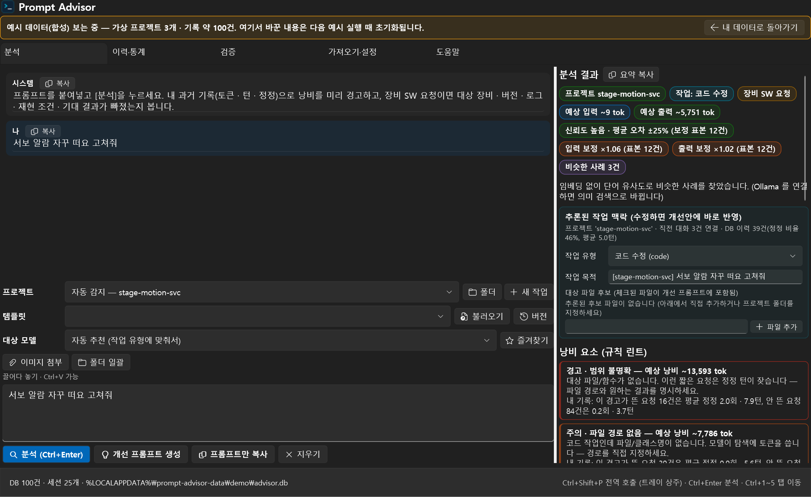
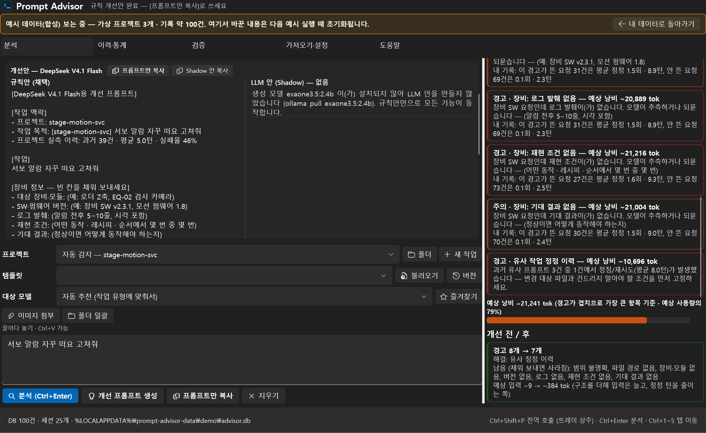

# Prompt Advisor

AI 코딩 도구(Claude Code · Cursor)에 보내기 **전에** 프롬프트를 점검하는 Windows 앱.
내 과거 기록(토큰 · 턴 · 정정 신호)으로 낭비를 경고하고, 반도체 장비 SW 요청이면 빠진 정보를 짚어 줍니다.
기록은 이 PC 에만 저장되고, LLM 은 로컬 Ollama 만 씁니다. Ollama 가 없어도 모든 기능이 규칙 기반으로 동작합니다.

[English summary](#english) · 사용자 매뉴얼: [`docs/manual/Prompt-Advisor-User-Manual-ko.pdf`](docs/manual/)



## 관점

장비 SW 를 AI 코딩 도구로 고칠 때, "서보 알람 자꾸 떠요 고쳐줘" 같은 짧은 요청은 대상 장비 · 버전 · 로그 · 재현 조건 · 기대 결과가 빠져 있습니다.
모델은 추측하거나 되묻고, 사람은 정정 턴을 반복하며 토큰을 씁니다. 이 앱은 그 낭비를 **보내기 전에** 막는 것을 목표로 합니다.

## 해결

| 기능 | 내용 |
|---|---|
| 내 기록으로 배운 경고 | Claude Code · Cursor 기록을 가져와 규칙별로 "이 경고가 뜬 요청은 정정 · 턴이 얼마나 더 들었는지"를 계산해 경고 옆에 붙입니다. 양쪽 표본이 3건 미만이면 수치를 쓰지 않습니다. |
| 장비 SW 요청 린트 (한/영) | 장비 · 설비 맥락의 요청에서 대상 장비/모듈 · SW 버전 · 로그 발췌 · 재현 조건 · 기대 결과가 빠졌는지 보고, 개선안에 채울 칸을 만들어 줍니다. |
| 토큰 예측 · 보정 | 비슷한 과거 요청(임베딩 또는 단어 유사도)으로 출력 토큰을 예측하고, 실제로 보낸 뒤 가져오면 예측과 실측을 이어 보정합니다 (표본 3건 미만이면 보정 안 함, 0.5~2.0 배로 제한). |
| 개선안 + Shadow | 규칙 개선안이 결정하고, 로컬 LLM 개선안은 옆 칸에만 보여줍니다. 주제 이탈 · 심사 점수 · 남은 경고 수를 기록하고, 기준을 넘으면 LLM 우선으로 전환할 수 있습니다. |
| 개선 전/후 추적 | 보낸 개선본을 기록해 두었다가 다음 가져오기 때 실제 턴 · 정정 수와 이어, 같은 경고가 있던 기존 요청과 비교합니다. |
| 현장 검증 절차 | 검증 탭: 재현(예시 · 내 사례 세트) → 비교(규칙 설정 전/후, 바뀐 항목만 강조) → Shadow → 전환 · 롤백(변경 이력 보관). |



## 상용 비교 · 차별점

조사일 2026-11-21. 각 제품의 공개 문서 기준이며, 확인하지 못한 항목은 적지 않았습니다.

| 제품 | 하는 일 | 이 앱과 다른 점 |
|---|---|---|
| [ccusage](https://github.com/ccusage/ccusage) | 로컬 로그로 코딩 CLI 토큰 · 비용 집계 | 사용 **뒤** 집계. 보내기 전 경고 없음 |
| [Claude Code `/usage` `/context`](https://code.claude.com/docs/en/commands) | 세션 사용량 · 컨텍스트 표시, `/insights` 지난 세션 보고 | 내장 기능. 요청 하나하나를 보내기 전에 점검하지 않음 |
| [promptlint-mcp](https://github.com/sean-sunagaku/promptlint-mcp) · [promptlint-cli](https://pypi.org/project/promptlint-cli/) | 규칙 린트, MCP, 토큰(·비용) 추정 | 영어 규칙, 과거 기록을 쓰지 않음 |
| [preflight](https://github.com/preflight-dev/preflight) | 작업 전 프롬프트 점수(MCP), 내 Claude Code 로그 색인 | Claude Code 전용, 영어 |
| [SpecStory](https://docs.specstory.com/specstory/introduction) | Cursor · Claude Code 대화를 파일로 저장 | 저장 · 공유. 분석 · 경고 없음 |
| [PromptLayer](https://www.promptlayer.com/) · [LangSmith](https://docs.langchain.com/langsmith/home) · [Helicone](https://docs.helicone.ai/) | LLM API 앱 추적 · 관측 | API 로 만든 앱 운영용. 채팅형 코딩 도구용이 아님 |
| [Not Diamond](https://notdiamond.ai/) | 입력별 모델 라우팅 (API) | 클라우드 서비스 |

이 앱의 차별점 (조사한 제품 중에서 찾지 못함, 2026-11 기준):

1. **Claude Code + Cursor 기록을 합쳐**, 경고마다 "내 기록에서 이 경고가 뜬 요청이 정정 · 턴을 얼마나 더 썼는지"를 붙여 보여줍니다.
2. **한국어 + 반도체 장비 SW 요청 린트**: 대상 장비 · 버전 · 로그 발췌 · 재현 조건 · 기대 결과.
3. **로컬 Ollama 로 개선안을 만들고 규칙안과 나란히 Shadow 비교**합니다. 프롬프트는 PC 밖으로 나가지 않고(보내기 전 마스킹), Windows 네이티브 화면입니다.

토큰 추정 · 모델 추천 · MCP 서버 자체는 다른 제품에도 있는 기능이라 차별점으로 내세우지 않습니다.

## 설치

1. [Releases](https://github.com/mhbae-semi-lab/prompt-advisor/releases) 에서 `prompt-advisor-win-Setup.exe` 를 받아 실행합니다.
   서명하지 않은 설치 파일이라 SmartScreen 이 뜨면 **추가 정보 → 실행** 을 누릅니다.
2. 설치 위치는 `%LOCALAPPDATA%\prompt-advisor`, 데이터는 `%LOCALAPPDATA%\prompt-advisor-data` 입니다. 제거해도 데이터는 남습니다.
3. 새 버전은 시작할 때 GitHub Releases 에서 확인합니다 (도움말 탭에서 끌 수 있음).

설치 없이 쓰려면 Releases 의 `prompt-advisor-win-Portable.zip` 을 풀어 `PromptAdvisor.exe` 를 실행합니다.

### Ollama (선택)

```powershell
winget install Ollama.Ollama   # 0.40.6 이상
ollama pull bge-m3             # 임베딩 (비슷한 과거 요청 찾기)
```

개선안 생성 기본 모델은 `bonsai-2.5:27b` 입니다 (PrismML Ternary Bonsai 2.5 27B, 2026-11-24, Apache 2.0).
Ollama 라이브러리에는 아직 없어 GGUF 를 받아 직접 만듭니다.
`ollama pull hf.co/prism-ml/Ternary-Bonsai-2.5-27B-GGUF:Q2_0` 는 PQ2_0 파일을 받아 일반 Ollama 가 읽지 못하니 쓰지 마세요.
Ollama 공식 `bonsai-2:27b` 는 이전 세대(Bonsai 2)입니다.

1. [Ternary-Bonsai-2.5-27B-Q2_0.gguf](https://huggingface.co/prism-ml/Ternary-Bonsai-2.5-27B-GGUF/resolve/main/Ternary-Bonsai-2.5-27B-Q2_0.gguf) (7.7GB) 를 받습니다.
2. 같은 폴더에 `Modelfile` 을 만듭니다.

   ```
   FROM ./Ternary-Bonsai-2.5-27B-Q2_0.gguf
   RENDERER qwen3.8
   PARSER qwen3.5
   PARAMETER temperature 1
   PARAMETER top_k 20
   PARAMETER top_p 0.95
   PARAMETER min_p 0.05
   ```

3. 그 폴더에서 `ollama create bonsai-2.5:27b -f Modelfile`

느린 모델입니다. RTX 3050 4GB · RAM 32GB 실측: 생성 약 1.8 토큰/초, 처음 불러오기 1~2분, 개선안 하나에 수 분.
빠른 답이 필요하면 `ollama pull exaone3.5:2.4b` 후 **가져오기 · 설정** 탭의 생성 모델 칸을 바꾸세요.

없으면 비슷한 요청 찾기는 단어 유사도로, 개선안은 규칙 기반으로 동작합니다.

## 사용

1. **가져오기 · 설정** 탭: Claude Code 세션 / Cursor 대화 / claude.ai 내보내기 zip / CSV 를 가져옵니다. 기록이 없으면 **예시 데이터로 둘러보기**(합성 DB, 가상 프로젝트 3개 · 100건).
2. **분석** 탭: 프롬프트를 붙여넣고 `Ctrl+Enter`. 경고 · 예상 토큰 · 비슷한 사례 · 모델 추천이 나옵니다.
3. **개선 프롬프트 생성**: 왼쪽 규칙안(채택)의 **프롬프트만 복사** 로 붙여넣습니다. 이때 보낸 개선본이 기록되어, 다음 가져오기 때 실제 턴과 이어집니다.
4. **검증** 탭: 규칙 설정을 바꾸기 전에 같은 세트로 전/후를 비교하고, 전환 · 롤백합니다.
5. **이력 · 통계** 탭: 라벨(최적/최악), 재현 세트 표시, 주간 리포트.

내 데이터 형식 (CSV): 머리줄 `source,session,project,created_at,in_tok,out_tok,turns,fail,label,text` (`text` 만 필수). 잘못된 줄은 줄 번호와 이유를 보여주고 건너뜁니다.

### 명령줄

```powershell
PromptAdvisor.exe --selftest [--data <폴더>]   # 셀프테스트, 결과: <데이터 폴더>\selftest-result.txt, 종료 코드 = 실패 수
PromptAdvisor.exe --demo                       # 합성 예시 DB 로 실행
PromptAdvisor.exe --shots <폴더> [--lang en]    # 예시 DB 로 화면 촬영 (매뉴얼용)
PromptAdvisor.exe --measure --demo             # 측정 요약 (규칙별 학습 수치 · 개선 추적 · Shadow · 보정)
PromptAdvisor.exe --shadow-eval                # 예시 10건 로컬 LLM Shadow 실측 → <데이터 폴더>\demo\shadow-eval.txt
PromptAdvisor.exe --mcp                        # MCP 서버 (stdio)
```

### 코딩 에이전트에서 쓰기 (MCP)

`advisor_stats` · `search_history` · `recommend_prompt` · `weekly_report` 도구를 제공합니다. 결과의 예시 문장은 마스킹됩니다.

```powershell
claude mcp add promptadvisor -- "$env:LOCALAPPDATA\prompt-advisor\current\PromptAdvisor.exe" --mcp
```

## 개인정보

- 기록은 `%LOCALAPPDATA%\prompt-advisor-data` 에만 저장합니다. 서버 · 계정 · 원격 수집이 없습니다.
- 가져오기는 이 PC 의 기록 파일을 읽기 전용으로 읽습니다.
- LLM 에 보내기 전 경로 · 메일 · API 키 · 토큰 · IP · 전화번호를 가리고, 보낸 내용을 화면에서 그대로 볼 수 있습니다. Ollama 주소가 이 PC 가 아니면 보낼 때마다 묻습니다.
- 오류는 이 PC 의 오류 기록과 `crash.log` 에만 남습니다.

## 빌드

```powershell
dotnet build -c Release
.\bin\Release\net9.0-windows\PromptAdvisor.exe --selftest --data $env:TEMP\pa-test
```

설치 파일 만들기 ([Velopack](https://velopack.io), `dotnet tool install -g vpk --version 1.2.161`):

```powershell
dotnet publish PromptAdvisor.csproj -c Release -r win-x64 --self-contained -o publish
vpk pack --packId prompt-advisor --packVersion 1.0.0 --packDir publish --mainExe PromptAdvisor.exe --packTitle "Prompt Advisor" --icon Assets\app.ico -o releases
```

## 구조

| 파일 | 역할 |
|---|---|
| `MainWindow.xaml(.cs)` | 분석 · 개선안 (`.History.cs` 이력 · 가져오기 · 설정, `.Verify.cs` 검증 탭 · 도움말, `.Shots.cs` 화면 촬영) |
| `Advisor.cs` | 린트 · 토큰 추정 · 분류 · 이웃 검색 · 모델 추천 · 개선안 · 마스킹 · 지식 내보내기 |
| `Domain.cs` | 장비 SW 린트, 규칙 설정, 내 기록으로 배운 경고 수치 |
| `Verification.cs` | 재현 · 비교 · Shadow 기준 · 개선 추적 계산 |
| `Importers.cs` | Claude Code jsonl · Cursor vscdb · claude.ai zip · CSV (줄 번호 오류, 형식 변경 감지) |
| `Store.cs` | SQLite (스키마 버전 · 단계별 마이그레이션) |
| `SampleData.cs` | 합성 예시 DB |
| `Loc.cs` · `Loc.Strings.cs` | 한/영 문자열 |
| `Updater.cs` · `Program.cs` | Velopack 설치 · 업데이트 |

## 한계

- 토큰 수는 Claude Code 기록에만 있습니다. Cursor 기록은 턴 · 정정만 있어 토큰 예측 보정에는 쓰이지 않습니다.
- "내 기록으로 배운 경고"는 상관 관계입니다. 경고 때문에 턴이 늘었다는 인과를 증명하지 않습니다.
- 예시 DB 의 수치(턴 · 정정)는 "장비 정보가 빠질수록 턴이 늘어난다"는 가정으로 만든 합성 값이라 기능 시연용입니다.
- 장비 SW 린트는 키워드 규칙입니다. 일반 요청에 뜨면 검증 탭에서 끄거나 기준을 바꿀 수 있습니다.
- 모델 가격표(`models.json`)는 참고용이며 자동으로 갱신되지 않습니다.
- 설치 파일은 서명하지 않았습니다.

이 앱은 AI 코딩 도구(Claude Code)의 도움을 받아 개발했습니다. 설계 판단과 검증은 작성자가 했습니다.

## English

Prompt Advisor is a Windows app that checks prompts **before** you send them to AI coding tools (Claude Code, Cursor).
It imports your local history (tokens, turns, correction signals), shows for each warning how much extra correction and turns your past requests with the same warning needed,
lints semiconductor-equipment software requests (Korean and English) for missing target equipment, version, log excerpt, repro conditions and expected result,
predicts output tokens with calibration, and builds a rule-based rewrite with a local-Ollama rewrite shown side by side as a shadow.
Everything stays on your PC; the app works fully without Ollama. The default generation model is `bonsai-2.5:27b` (PrismML Ternary Bonsai 2.5 27B), built from its Q2_0 GGUF with `ollama create` — see the Ollama section; it is slow on a 4GB GPU (about 1.8 tokens/s). The UI is available in Korean and English (Settings → Language).
Install from Releases (`prompt-advisor-win-Setup.exe`, unsigned — choose "More info → Run anyway" on SmartScreen).

License: MIT
